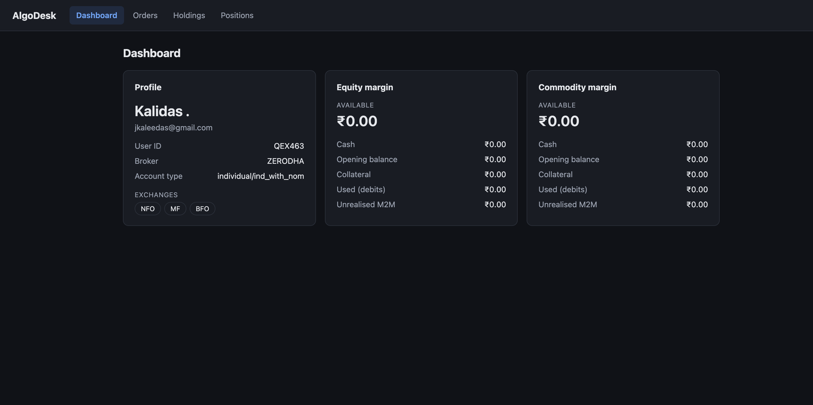
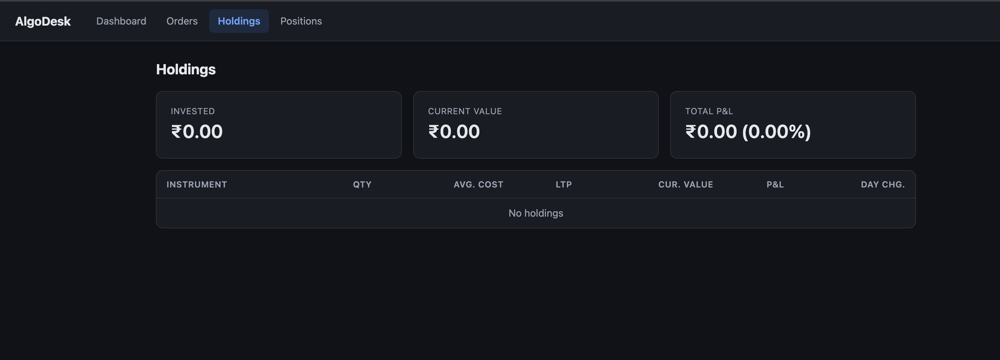

# AlgoDesk

AlgoDesk is a trading app I'm building **to learn how to automate trading** on Indian markets using Zerodha's [Kite Connect API](https://kite.trade/docs/connect/v3/).

It starts with the basics — logging in through Kite, viewing your account, orders, holdings and positions — and grows step by step towards running rule-based strategies automatically.

> **Disclaimer:** This is a personal learning project, not financial advice and not production trading software. Automated trading can lose real money quickly. Test with small amounts or paper trading first.

## Features

**Available now**
- Log in with your Zerodha account via Kite Connect (OAuth-style flow with CSRF `state` check)
- Broker access token stored server-side in the database — never sent to the browser
- Session-based authentication; expired Kite tokens (reset daily at 6 AM IST) force a fresh login
- Dashboard with profile and equity / commodity margins
- Orders (today), Holdings and Positions pages with P&L

**Planned**
- Live market data over WebSocket
- Placing and managing orders from the app
- Rule-based strategies with paper trading mode
- Risk controls (max loss per day, kill switch)

## Screenshots

**Dashboard:** profile and margins



**Holdings:** portfolio summary and holdings table



## Tech stack

| Layer | Technology |
|---|---|
| Language | Java 17 |
| Framework | Spring Boot 3.3 (Web, Security, Data JPA) |
| Broker API | Kite Connect API v3, Kite Connect Java SDK |
| Database | PostgreSQL |
| Frontend | Plain HTML, CSS and JavaScript (served by Spring Boot) |
| Build | Maven |

## How it works

```
Browser ──► AlgoDesk (Spring Boot) ──► Kite Connect API
  │              │
  │              ├─ Controller   pages + /api/** JSON endpoints
  │              ├─ Service      business logic (profile, orders, portfolio)
  │              ├─ Kite client  adds auth headers, calls Kite, unwraps responses
  │              └─ Repository   users and access tokens (PostgreSQL)
  │
  └─ only ever talks to AlgoDesk; never sees the Kite token or Kite URLs
```

Login flow: `/` → `/login` → Kite login page → `/kite/callback` → token exchanged and saved → `/dashboard`.
See [docs/kite-auth-flow.md](docs/kite-auth-flow.md) for the details.

## Project structure

```
src/main/java/com/app/algodesk/
├── authentication/   session filter, security config, login service, per-request context
├── broker/           broker-neutral interfaces and models
│   └── kite/         Kite Connect implementation
├── controller/       page and API endpoints
├── service/          profile, orders, portfolio
├── entity/           JPA entities (users, auth tokens)
├── repository/       Spring Data repositories
└── appsetup/         constants

src/main/resources/static/
├── *.html            one page per nav item
├── css/app.css       shared styles
└── js/               common.js + one script per page
```

## Getting started

### Prerequisites
- JDK 17
- PostgreSQL
- A Kite Connect developer app from [developers.kite.trade](https://developers.kite.trade/), with the redirect URL set to
  `http://localhost:8080/kite/callback`

### Configure
Secrets are read from environment variables, so `application.yml` never contains real values. Set these before running (in your shell or your IDE's run configuration):

| Variable | Value |
|---|---|
| `KITE_API_KEY` | API key of your Kite Connect app |
| `KITE_API_SECRET` | API secret of your Kite Connect app |
| `DB_USERNAME` | PostgreSQL user (defaults to `root`) |
| `DB_PASSWORD` | PostgreSQL password |

The database URL is in `src/main/resources/application.yml`
(`jdbc:postgresql://localhost:5432/trade_db?currentSchema=tradedb` by default).

### Run

```bash
./mvnw spring-boot:run
```

Open [http://localhost:8080](http://localhost:8080) and log in with your Zerodha account.

> Kite access tokens expire every day at 6 AM IST, so you'll need to log in again each trading day.

## Docs
- [Kite auth flow](docs/kite-auth-flow.md)
- [Architecture](docs/ARCHITECTURE.md)
- [Build guide](docs/BUILD-GUIDE.md)
